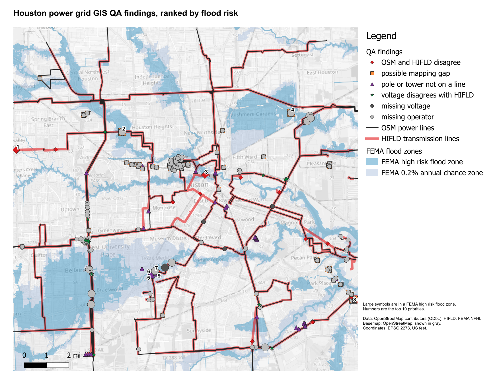
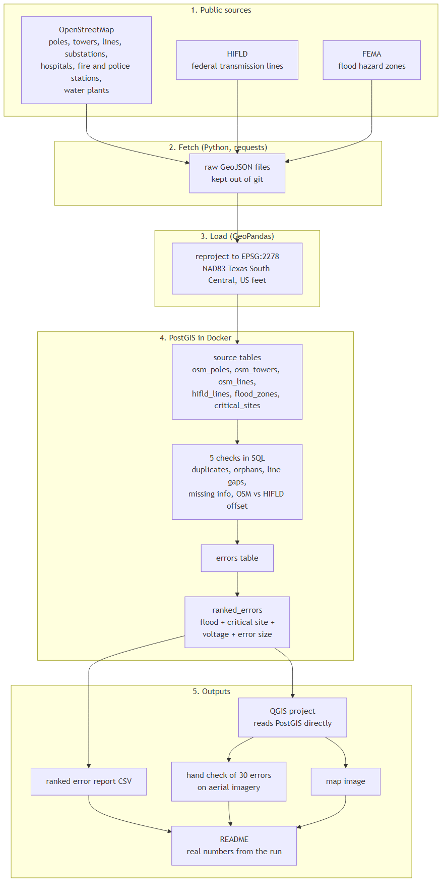

# Detecting and Prioritizing Utility Asset Location Errors in GIS Maps

Location errors are found by flagging where two independent sources disagree.



[Open the interactive map of all 474 findings](output/findings.geojson). Zoom in and click
any point for its check, detail and flood zone.

Automated QA/QC of public power grid GIS data for central Houston, ranked by flood risk so
the problems most likely to slow storm restoration come first.

## Findings

- 18 of 37 independent HIFLD transmission lines disagree with OpenStreetMap by more than
  100 ft. Four are off by over 2,000 ft, two of them in FEMA high risk flood zones.
- 61 lines never reach a substation, possible mapping gaps.
- 45 poles and towers are not on any line.
- 12 lines have a voltage that differs from HIFLD on the same route.
- Separately, 338 voltage or operator values are blank across 211 lines, gaps in volunteer
  tagging.
- 36 findings sit in FEMA high risk flood zones and are ranked first.

These are leads for field or engineering review, not confirmed errors.

## How it works

<picture>
  <source media="(prefers-color-scheme: dark)" srcset="documentation/architecture-dark.png">
  
</picture>

Public data is downloaded, converted to US feet and loaded into PostGIS. Three groups of
checks write their findings to one table, which is ranked by flood risk and turned into a
report and the QA map. A separate script recounts every check from the raw files and
confirms the same features are flagged.

## How the results were checked

- 35 unit tests run each check on small shapes with a known answer, in a separate test
  database.
- A second script recomputes every check from the raw files with GeoPandas instead of SQL.
  All eight checks flag the same features. It also caught a bug: sampling HIFLD every
  100 ft missed a disagreement between samples. Sampling every 5 ft fixed it, 17 became 18.
- Loaded counts match separate count queries to each source.
- The top findings were viewed over satellite imagery. They are real disagreements in the
  data, but imagery cannot show which source is right.

## Checks

| Group | Check | Tolerance |
|-------|-------|-----------|
| location | conflation-style check, independent HIFLD line vs nearest OSM major line | over 100 ft, sampled every 5 ft |
| network connectivity validation | pole or tower not on a line | over 5 ft |
| network connectivity validation | group of touching lines that never reaches a substation | touching within 1 ft, substation within 50 ft |
| attributes | voltage differs from HIFLD on the same route | route match within 100 ft |
| attributes | bad voltage format, operator spelling variants (none found) | |
| attributes | missing voltage or operator | |

Neither source is treated as correct. Findings are sorted by flood risk (FEMA A, AE and AO
zones, then the 0.2 percent annual chance zone, then the rest), then by check in the order
above, then by distance or line length within the same check.

## Top 10

All in FEMA AE zones.

| # | Check | Feature | Finding |
|---|-------|---------|---------|
| 1 | OSM vs HIFLD | HIFLD 301992 | not in OSM within 1,000 ft, 6,400 ft at worst |
| 2 | OSM vs HIFLD | HIFLD 303822 | not in OSM within 1,000 ft, 2,348 ft at worst |
| 3 | OSM vs HIFLD | HIFLD 300203 | 199 ft apart |
| 4 | pole not on a line | OSM node 13768864962 | 251 ft from nearest line |
| 5 | pole not on a line | OSM node 13768864961 | 215 ft from nearest line |
| 6 | pole not on a line | OSM node 13765423444 | 23 ft from nearest line |
| 7 | pole not on a line | OSM node 13768864960 | 18 ft from nearest line |
| 8 | possible mapping gap | OSM way 312670853 | 4,127 ft minor line, no substation |
| 9 | possible mapping gap | OSM way 1509655251 | 257 ft minor line, no substation |
| 10 | possible mapping gap | OSM way 1307620248 | 73 ft minor line, no substation |

## Data

All data is real and public. No CenterPoint internal data is used and nothing is
synthetic.

| Source | Used for | As of |
|--------|----------|-------|
| OpenStreetMap | 1,777 poles, 1,650 towers, 63 substations, 463 major and 88 minor power lines | 17 Oct 2026 |
| HIFLD transmission lines | reference layer, 148 lines, 111 copied from OSM and skipped | mapped 2017 |
| FEMA National Flood Hazard Layer | 1,209 flood zone polygons | 17 Oct 2026 |

Study area: about 15 by 14 miles around downtown Houston. Distances in EPSG:2278, NAD83
Texas South Central, US feet. 418 of the 463 OSM major lines carry a voltage, all 69 to
345 kV. Operator names come from public OSM tags and HIFLD, not utility records.

## Limits

- HIFLD content is from 2017 to 2018. Lines rebuilt since then show up as disagreements
  even if OSM is right today.
- OSM has only 9 miles of minor, usually distribution, line here, so this is mostly a transmission check.
- Underground lines may be missing from one source, which looks like a disagreement or gap.
- In shared corridors a 69 kV and a 138 kV line can run within 100 ft of each other, so a
  voltage disagreement can come from matching two different lines.
- A possible mapping gap can be a line that really ends at a customer or plant, not a gap.

## How to run

Needs Docker, Python 3.12 and QGIS 3.44 LTR.

```
copy .env.example .env          then fill in the values, port 5433
docker compose up -d
python -m venv .venv
.venv\Scripts\activate
pip install -r requirements.txt
pytest
python fetch.py
python run.py
python verify.py
"C:\Program Files\QGIS 3.44.15\bin\python-qgis-ltr.bat" qgis\make_map.py
```

## Stack

Python (GeoPandas, pandas, SQLAlchemy), PostgreSQL 17 with PostGIS 3.5 in Docker, QGIS.
The checks use standard spatial operations (nearest distance, buffers, spatial joins, flood
zone overlay) that have direct equivalents in ArcGIS.
