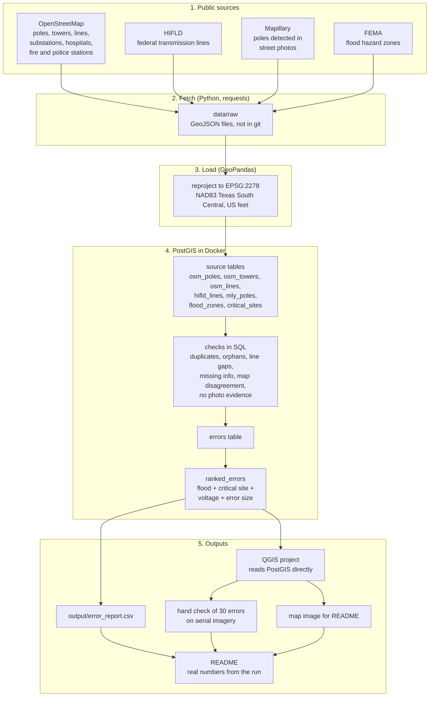

# Architecture

This project checks public Houston power grid maps for location errors by comparing
independent sources that describe the same equipment. Where they disagree, at least
one of them is wrong. All data is real and public.

## Flow

## What each tool does

| Tool | Job |
|------|-----|
| Python + requests | downloads each source into data/raw |
| GeoPandas | reads the files, converts every layer to US feet, writes them to PostGIS |
| PostgreSQL + PostGIS | stores the layers and runs the distance and overlap checks |
| pandas | turns the ranked errors into the CSV report and summary numbers |
| QGIS | shows the errors on a map and is used to hand check a sample |
| Docker | runs PostGIS the same way on any machine |

## Why US feet

Lat and long are angles, so distances measured in them are not real lengths.
EPSG:2278 is a flat projection made for this part of Texas, so a distance of 50
means 50 feet on the ground. Every check uses it.
